# Actualización 1.1.0

En la pantalla inicial de Foundry, entra en **Sistemas de juego → MR- Eat the Reich → Actualizar**. El manifiesto estable enlaza con la última versión publicada y su ZIP. Después abre el mundo y recarga los clientes.

Los mundos nuevos comienzan en la sala de despliegue. En un mundo ya iniciado, abre **Configuración → Eat the Reich → Presentación de jugadores**. Encontrarás instrucciones en **docs/PRESENTACION.md** y la selección musical por acontecimiento en **docs/GUIA_MUSICAL.md**. No es necesario reimportar la aventura.

<p align="center">
  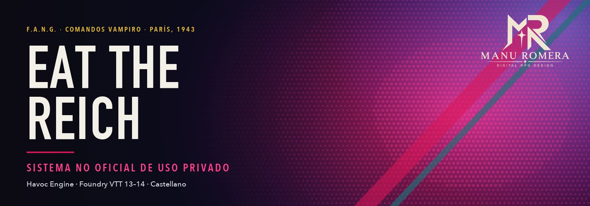
</p>

<p align="center">
  <a href="https://github.com/ManuRomera"></a>
  <a href="https://github.com/ManuRomera/mr-eat-the-reich/releases/latest"></a>
  
  
  
</p>

<p align="center">
  <a href="https://github.com/ManuRomera/mr-eat-the-reich/releases/latest/download/mr-eat-the-reich.zip"></a>
  <a href="https://github.com/ManuRomera/mr-eat-the-reich/releases/latest/download/system.json"></a>
</p>

# MR- Eat the Reich

**París, 1943.** Un escuadrón de vampiros cae del cielo en ataúdes de acero con un único objetivo: beberse a Hitler. Este es un sistema **no oficial y de uso privado** para jugar a *EAT THE REICH* (Grant Howitt y Will Kirkby; Rowan, Rook and Decard) en **Foundry VTT**, con todo el ruido del manual: hojas con forma de ataúd, rotulador rojo sangre, decorados de neón… y **una partitura elegida según lo que sucede en cada escena**.

> Repositorio privado. No está publicado ni puede publicarse tal cual: lee [NOTICE.md](NOTICE.md) antes de compartirlo.

## La hoja es un ataúd abierto

La ventana no es un rectángulo: son **la tapa**, con el vampiro a cuerpo entero, y **la caja**, con la hoja dentro y el texto ceñido a su forma. Marco de acero remachado, forro del color de cada personaje y cuatro pestañas —Acción, Poderes, Heridas, Dosier—. Si algo no cabe, la letra se encoge sola; el ataúd entero se ajusta a tu pantalla. Pulsa un atributo y tiras.

<p align="center">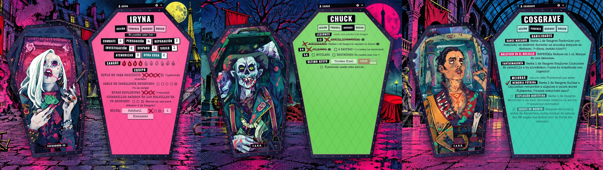</p>

## Nada de casillas perfectas

Casillas torcidas y **X a rotulador rojo sangre que se salen del hueco** para los usos gastados y las lesiones; vistos para las mejoras; gotas y salpicones para la Sangre; nombres tachados. La ficha rectangular sigue ahí para crear y editar vampiros propios.

<p align="center">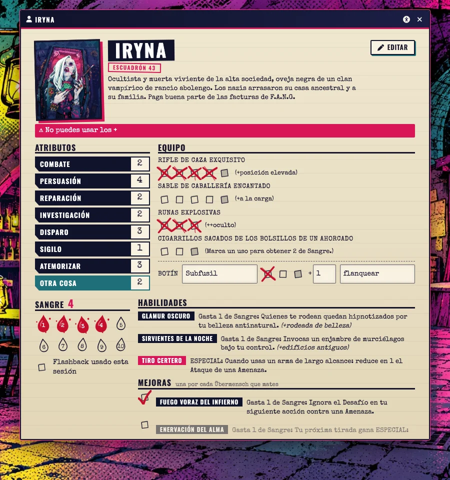</p>

## La tirada y la misión

El **resultado va estampado en grande**. Cada éxito se gasta pulsando su dado —Objetivo, Amenaza, Defensa, Sangre o un ESPECIAL con los seises— y el Desafío se descuenta solo. Los dados de bonificación y el flashback se tiran desde la tarjeta; al terminar el turno, los ataques sin defender marcan la lesión y derriban si toca. El **Panel de misión** lleva Objetivos, Amenazas, turnos y refuerzos, carga cualquiera de las 19 localizaciones con sus enemigos y pone la música.

<p align="center">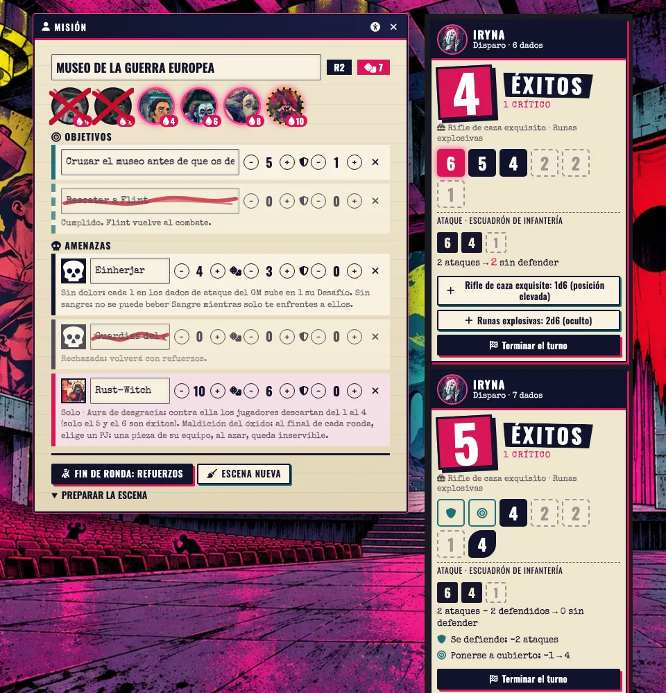</p>

Las reglas propias de los enemigos van automatizadas: «Solo», Anatema (Vampirjäger), Aura de desgracia (Rust-Witch), Sin dolor y Sin sangre (Einherjar), las garras del Werhund y el despliegue rápido de los paracaidistas.

## París en veinte escenas

El mapa del manual con **una calavera por localización**: doble clic y estás en su decorado a pantalla completa. En cada escena, tres notas: volver al mapa, leer el resumen y **la página del manual** de ese sitio.

<p align="center">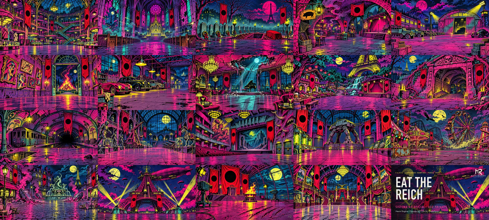</p>

Y cada amenaza con su imagen:

<p align="center">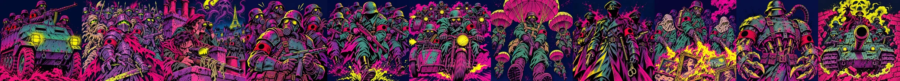</p>

## Preparar la tirada

Sin cajas: el atributo elegido va **rodeado a rotulador**, cada cacharro y cada poder tiene su casilla torcida y, al usarlo, **el aspa roja** se sale del hueco. El botón dice cuántos dados vas a tirar. En modo oscuro, lo mismo sobre noche.

<p align="center">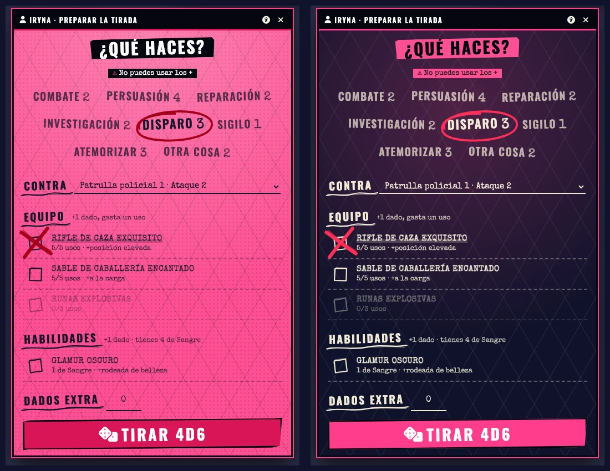</p>

## Dados punk

Con **Dice So Nice**, cada vampiro tira dados **del color de su ataúd**, con números a máquina y **la calavera con colmillos en el 6**. Los del GM son negros con el canto rojo. Cada jugador puede quitar los dados punk o el color desde los ajustes del sistema.

<p align="center">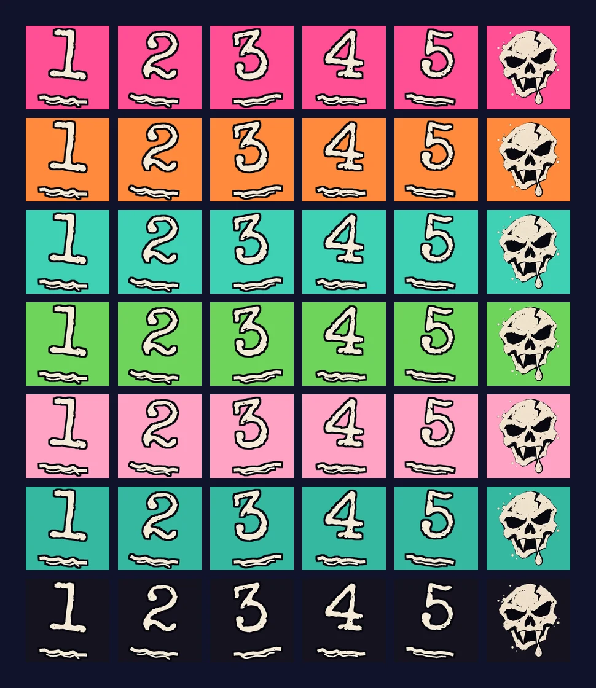</p>

## Presentación del escuadrón

La partida empieza en la **sala de despliegue**: cada vampiro se presenta con su ataúd, su ilustración y su canción. La puerta se abre y se ve por dentro; el soporte se queda con el ataúd. Los menús de Foundry siguen a mano, así que cada jugador puede abrir su ficha mientras se presenta. Desde el control se marca **quién juega**, se para o se pone la música y, al salir, la mesa va al mapa de París.

<p align="center">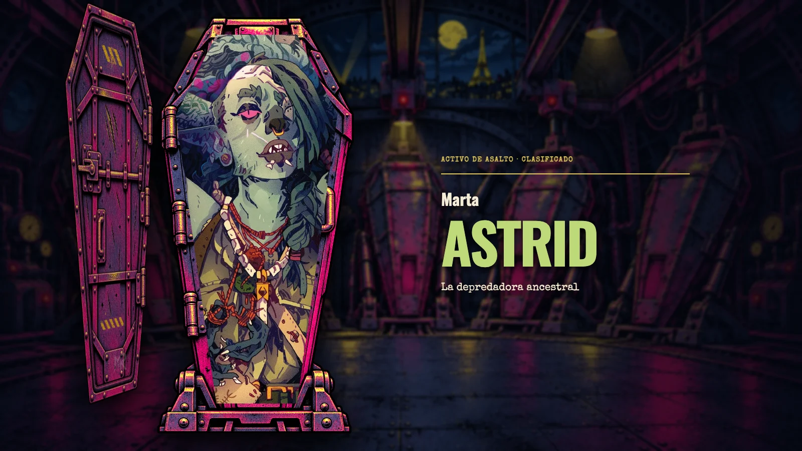</p>

## El mapa manda

En las dos notas amarillas del mapa de París van, con datos vivos, el nombre de la campaña y el **escuadrón**: retrato, jugador, sangre y lesiones de cada vampiro, y el avance por sectores. Doble clic en un retrato abre su ficha; al dejar el ratón encima un segundo, la ilustración se ve en grande. Quien dirige tiene ahí **¿Quién juega?** y **Reiniciar** (deja la partida a cero, con confirmación). Las escenas resueltas pierden la calavera y quedan con el nombre tachado.

<p align="center">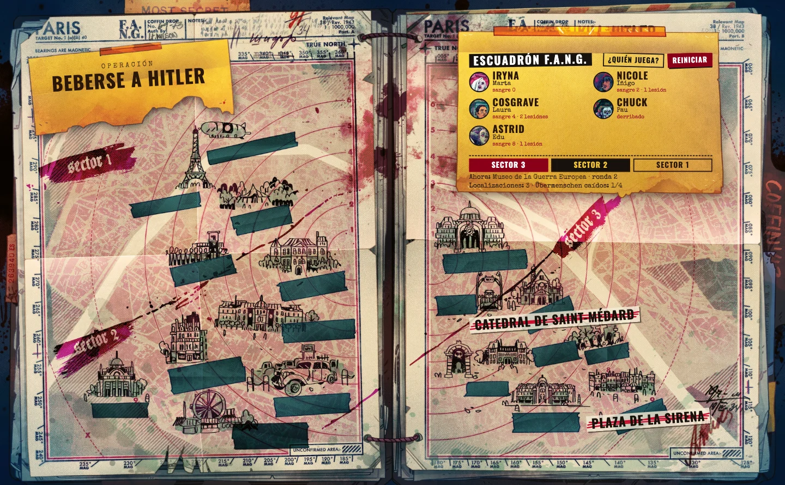</p>

## Lanzamiento

Tal como dice el manual, la mesa **elige dónde caer** entre los seis puntos del Sector 3. Al pulsar uno sale la diana con su ficha y quien dirige da la orden: la mesa va al decorado, los ataúdes caen uno a uno con su explosión, el humo lo tapa todo y, al despejarse, están clavados en el suelo y el sitio destrozado. Hay decorado para 3, 4 y 5 ataúdes, según cuántos vampiros jueguen. Alt + doble clic en un punto deja a quien dirige asomarse sin lanzar nada.

<p align="center">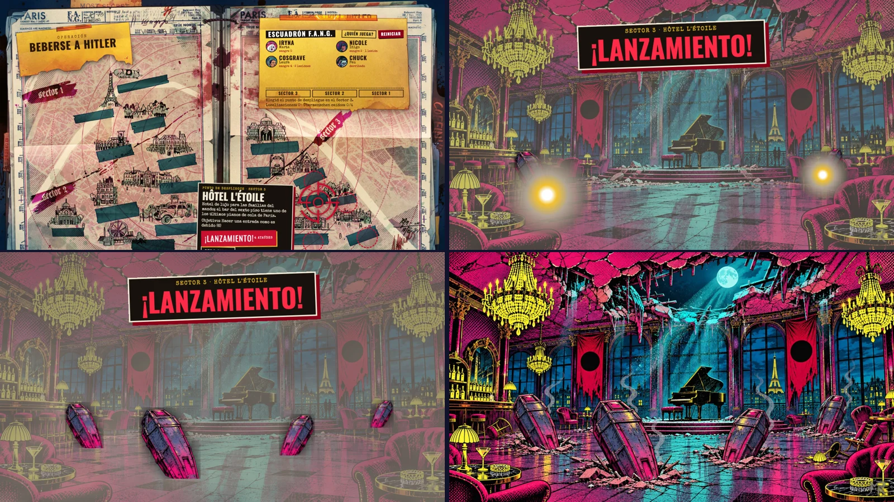</p>

El **Ataúd metálico de despliegue** sigue en **Actores → Atrezo** por si quieres colocar alguno a mano en cualquier escena.

## Turnos a la vista

Dar el turno desde el Panel de misión lo **estampa en pantalla** para toda la mesa, una sola vez y con su golpe de sonido: de quién es y cuántos dados le disparan. Nada de mensajes repetidos en el chat.

<p align="center">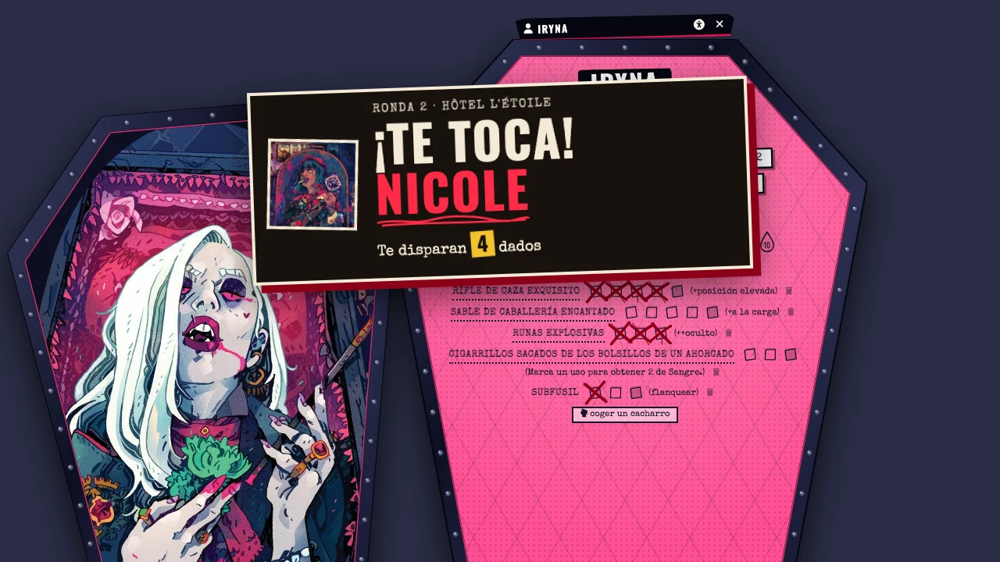</p>

## Música de escena y temas de los protagonistas

La banda sonora incluye **30 grabaciones**: temas de las 20 localizaciones, alternativas para siete cambios de situación, una sala de presentación y apoyos para maquinaria de guerra y último gesto. Cada selección responde a los acontecimientos del manual: persecución, funeral, refugio de la Resistencia, transformación demoníaca o asalto. La ópera emplea un fragmento vocal de Wagner. Los efectos anteriores se sustituyen por 29 efectos de foley y armas; véase [docs/EFECTOS.md](docs/EFECTOS.md).

Las fuentes, autores y licencias CC BY 4.0 y CC BY-SA 3.0 se detallan en [assets/audio/CREDITOS.md](assets/audio/CREDITOS.md) y en **Configurar ajustes → MR- Eat the Reich → Créditos**. El audio está incluido y no necesita conexión durante la partida. Se ha ajustado su sonoridad y suavizado el reinicio con un fundido; no se garantiza un bucle musical perfecto.

Las canciones aportadas por el director se conservan sin alterar y se añaden a la lista musical. Con **MR- Dirección 0.5.1**, aparecen seis botones en **Motivos**:

| Botón | Canción |
|---|---|
| Iryna | The Last Velvet Dynasty |
| Chuck | A Decent Man with Bad Teeth |
| Cosgrave | Dead Men Owe Me Money |
| Nicole | Nothing Left to Lose |
| Flint | Born Below the World |
| Astrid | The Taiga Inside My Heart |

Pulsa un nombre para activar su tema. Vuelve a pulsarlo para recuperar el fondo de la escena. Sin MR- Dirección, se pueden activar desde el selector de música del Panel de misión o desde Listas de reproducción. La integración está en el sistema y no requiere sustituir ni modificar el módulo.

## Actualizar la instalación existente

Cierra el mundo y, en la pantalla inicial de Foundry, abre **Sistemas de juego → MR- Eat the Reich → Actualizar**. La versión debe cambiar a **1.1.0**. Abre el mundo y recarga los navegadores; la presentación, la música y el atrezo se actualizan sin reimportar la aventura. Se conservan personajes, diarios y posiciones de tokens, además de listas musicales externas y fondos personalizados fuera de los recursos del sistema.

Manifiesto estable para instalar o vincular el sistema:

```text
https://github.com/ManuRomera/mr-eat-the-reich/releases/latest/download/system.json
```

Para instalar manualmente, descarga **mr-eat-the-reich.zip** de la última release y extrae su contenido en **Data/systems/mr-eat-the-reich**, con Foundry cerrado. El ZIP de Foundry contiene system.json en la raíz y el compendio compilado.

Con **[MR- Dirección](https://github.com/ManuRomera/mr-direccion)** (opcional) el sistema entrega la misión entera a su barra: escenas, lectura, música con fundido cruzado, nueve motivos, efectos, reparto de enemigos, un hito por Übermensch y el reloj «Hasta el amanecer».

## Lo de siempre

Ventanas con memoria, accesibilidad en la cabecera (tamaño, modo oscuro, alto contraste, fuente legible, sin movimiento), encuadre de retratos, lupa, seguridad en la sesión (líneas, velos, Pausa, Velo y Tarjeta X anónimos), diagnóstico y créditos en Ajustes.

## Instalación

Al ser un repositorio privado, Foundry no puede leer el manifiesto sin tu sesión de GitHub. Dos caminos:

1. **Clonar** el repositorio en `Data/systems/mr-eat-the-reich` (lo recomendado: incluye las herramientas).
2. **Descargar el zip** de la [última versión](https://github.com/ManuRomera/mr-eat-the-reich/releases/latest) con la sesión iniciada y descomprimirlo en `Data/systems/`.

En los dos casos faltan las ilustraciones del libro, que no se distribuyen: se sacan de tu PDF (ver abajo).

## De dónde sale cada cosa

| Qué | Origen | ¿En el repo? |
|---|---|---|
| Retratos, mapa y páginas del manual (`assets/libro`, `assets/retratos`) | Tu PDF, con `npm run arte` | No (copyright de Will Kirkby y RR&D) |
| Decorados de las 19 localizaciones y 11 amenazas (`assets/escenas`, `assets/amenazas`) | Generados con Codex para este sistema, sin usar el arte del libro como referencia; firmados con la marca MR | Sí |
| Música (`assets/audio/musica`) | Punk/rock instrumental CC BY 4.0 o CC0 1.0; temas de personaje aportados por el director; ver `assets/audio/CREDITOS.md` | Sí |
| Efectos (`assets/audio/sfx`) | Sintetizados con `tools/audio.py sfx` | Sí |

## Ponerlo en marcha

```bash
npm run arte -- "/ruta/a/tu/Eat_the_Reich.pdf"
```

```bash
npm run build
```

`arte` saca las ilustraciones de tu PDF a `assets/` (no se versionan). `build` genera `_data/aventura.json` y compila el compendio; **Foundry tiene que estar cerrado**. Después crea un mundo con el sistema «MR- Eat the Reich» (ya hay uno de pruebas: `etr-pruebas`).

## Qué queda manual

- Los efectos de los ESPECIALES y de las habilidades pasivas (Devorador de cadáveres, Armadura de huesos, Suerte de muerto, Fluidos corrosivos, Alimentarse del miedo): la tarjeta los anuncia y cuenta los «1»; los números se ajustan con los +/− del Panel de misión o en la hoja.
- La Maldición del óxido de Rust-Witch (el parte de refuerzos la recuerda).
- Las recompensas de los objetivos secundarios.

## Dudas de transcripción

- **Nicole, «Disparo en la cabeza»:** la ficha traducida no trae efecto. Está vacío; se rellena en Editar.
- **Cosgrave, «Suerte de muerto»:** la ficha traducida dice «por cada dado que tiraste», que anularía siempre el ataque. Se ha dejado remitiendo al manual.
- **Derribo:** el manual dice 3 ataques en una página y 4 en otra. Por defecto 3; se cambia en Ajustes.

## Comprobaciones

```bash
npm test
```

Sin Foundry: `tests/arnes.html` pinta las plantillas reales con el CSS de Foundry (instrucciones en el propio archivo).
**No se ha probado en un Foundry real** (ni v13 ni v14, ni con Dice So Nice): es lo primero que hay que hacer.

## Comprobaciones de esta edición

```sh
node tests/contenido.mjs
```

La prueba comprueba la migración concurrente sin duplicados, 28 referencias de audio, seis motivos de personaje, 20 escenas con pistas distintas, conservación de ajustes externos, imagen limpia, creación de un solo actor de atrezo, ausencia de despliegue automático y permisos de colocación. El paquete se valida también con el esquema real de MR- Dirección 0.5.1. Se comprueban sintaxis, rutas, huellas digitales, transparencia y decodificación de audio. El instalador se prueba en una copia temporal, incluyendo la detección de conflictos.

No se ha probado esta versión dentro de una instancia real de Foundry ni se ha realizado una audición completa de todas las pistas. La copia instalada permanece sin cambios.
